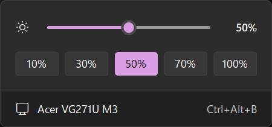

# Monitor Brightness

Control your **external monitor's brightness from Windows**, with no need to reach for the monitor's physical buttons.

Windows' own brightness slider only works for built-in laptop screens. This small tray app talks to external monitors over **DDC/CI** (the standard most modern monitors support) and gives you a panel that looks like Windows 11's quick settings.



## Features

- **Tray icon:** click the sun icon to open the brightness panel. It's styled like Windows 11 quick settings and uses your accent colour and light/dark theme.
- **Slider and presets:** drag the slider or click 10 / 30 / 50 / 70 / 100%. The mouse wheel and arrow keys work too.
- **Global hotkeys:**

  | Keys | Action |
  |---|---|
  | `Ctrl + Alt + B` | Open / close the panel |
  | `Ctrl + Alt + Page Up` | 10% brighter |
  | `Ctrl + Alt + Page Down` | 10% dimmer |

- **Starts when you sign in:** it runs quietly in the tray.
- **Sharp on every screen:** it handles a different scaling (DPI) on each monitor.
- **Light:** no installer, no admin rights, no dependencies. It uses Windows PowerShell 5.1, which is built into Windows.

## Requirements

- Windows 10 or 11 (the rounded corners need Windows 11).
- An external monitor with **DDC/CI turned on**. It's usually on by default. If not, look for "DDC/CI" in the monitor's own on-screen menu.

## Install

1. Download this repo: **Code → Download ZIP**, then extract it. Or clone it:
   ```
   git clone https://github.com/pratikpwr/monitor-brightness.git
   ```
2. In the extracted folder, run:
   ```
   powershell -ExecutionPolicy Bypass -File install.ps1
   ```

The installer:
- copies the app to `%LOCALAPPDATA%\MonitorBrightness`
- adds a **Monitor Brightness** shortcut to the Desktop, the Start menu and your Startup folder
- starts the tray app

Running the shortcut while the app is already running opens the panel.

## Command line

`brightness.ps1` sets the brightness without the tray app:

```
powershell -ExecutionPolicy Bypass -File brightness.ps1        # show current level
powershell -ExecutionPolicy Bypass -File brightness.ps1 40     # set to 40%
powershell -ExecutionPolicy Bypass -File brightness.ps1 +10    # 10% brighter
```

## Customise

The installed files are in `%LOCALAPPDATA%\MonitorBrightness`.

- **Hotkey step:** `$Step = 10` near the top of `tray.ps1`.
- **Preset buttons:** `Presets = { 10, 30, 50, 70, 100 }` in `ui.cs`.

After editing either file, right-click the tray icon → **Exit**, then open the **Monitor Brightness** shortcut again.

## Uninstall

```
powershell -ExecutionPolicy Bypass -File "%LOCALAPPDATA%\MonitorBrightness\install.ps1" -Uninstall
```

## Troubleshooting

- **"No monitor answered DDC/CI":** turn on DDC/CI in the monitor's menu. Some docks, KVM switches and adapters (often DisplayLink) don't pass DDC/CI through. Try connecting the monitor directly.
- **A hotkey does nothing:** another app may already use it. The tray app shows a notification at start-up if a hotkey couldn't be registered.
- **The tray icon doesn't appear after a restart:** check *Settings → Apps → Startup* and turn on **Monitor Brightness**.
- **Errors** are logged to `%LOCALAPPDATA%\MonitorBrightness\tray.log`.

## How it works

| File | Role |
|---|---|
| `ddc.cs` | Reads and sets brightness through the Windows monitor configuration API (`dxva2.dll`, DDC/CI). |
| `ui.cs` | Draws the flyout, slider and buttons in the Windows 11 style, reads the theme and accent colour, and registers the global hotkeys. |
| `tray.ps1` | The tray app. Runs a single instance and limits DDC/CI writes while you drag (the bus is slow). |
| `install.ps1` | Per-user install, update and uninstall. |
| `brightness.ps1` | Command-line tool. |

The C# files are compiled at start-up by PowerShell's `Add-Type`, so there is nothing to build.

## License

[MIT](LICENSE)
